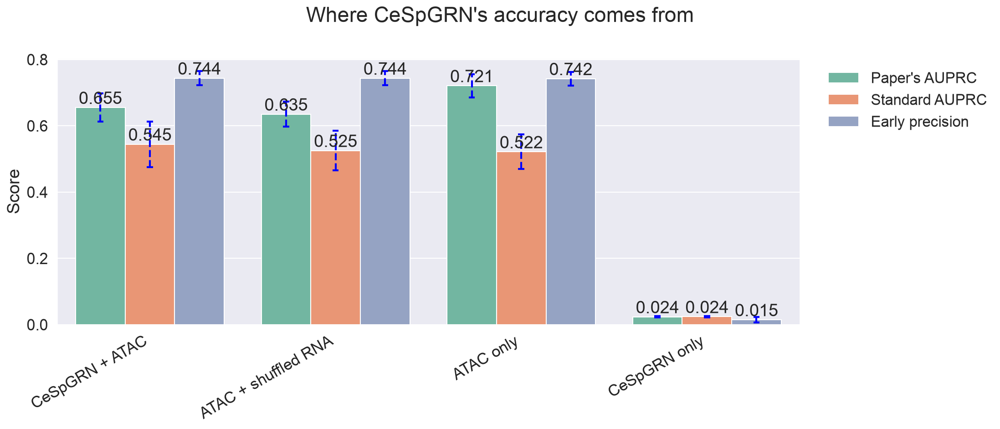
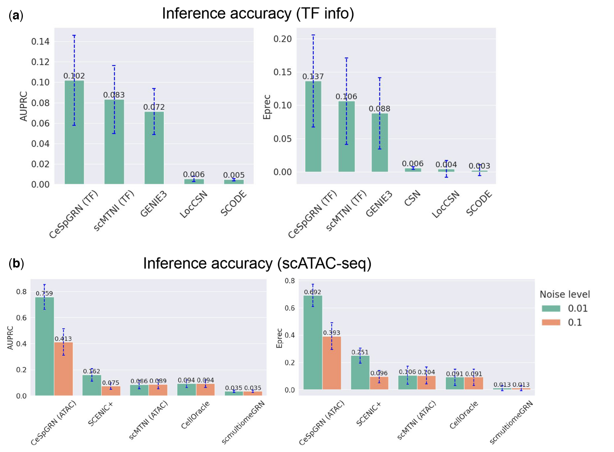
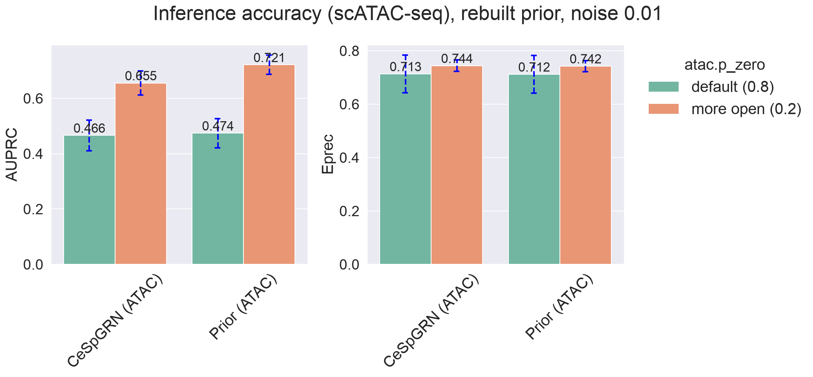
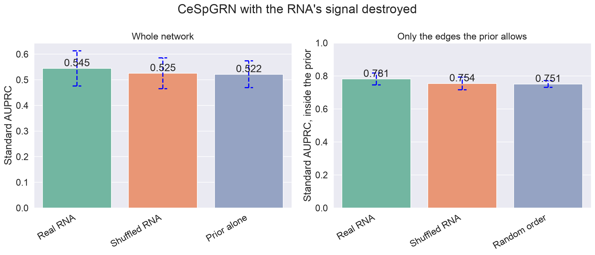
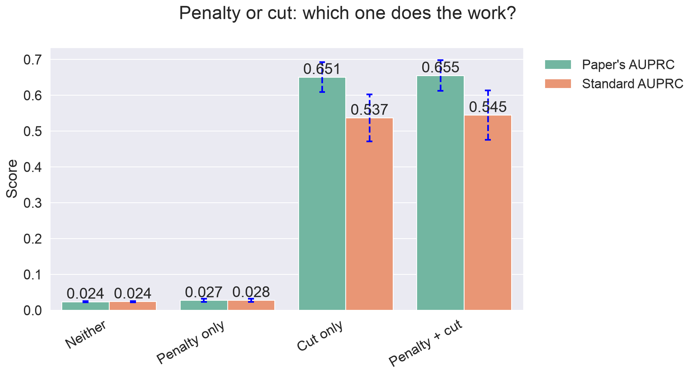
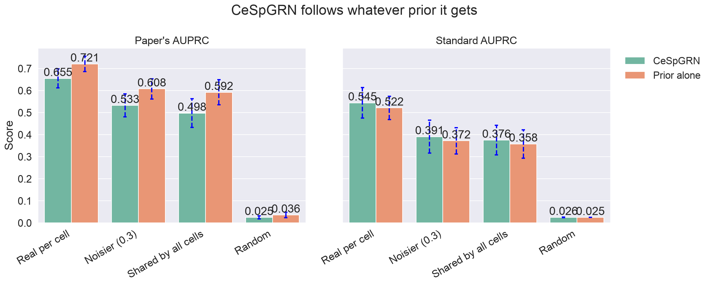
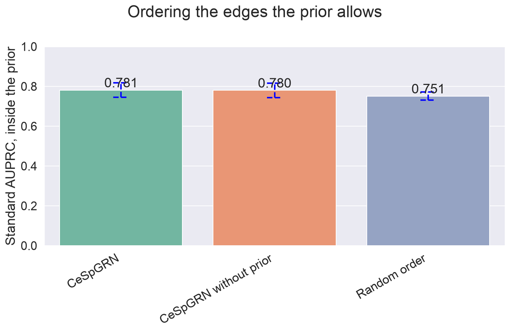
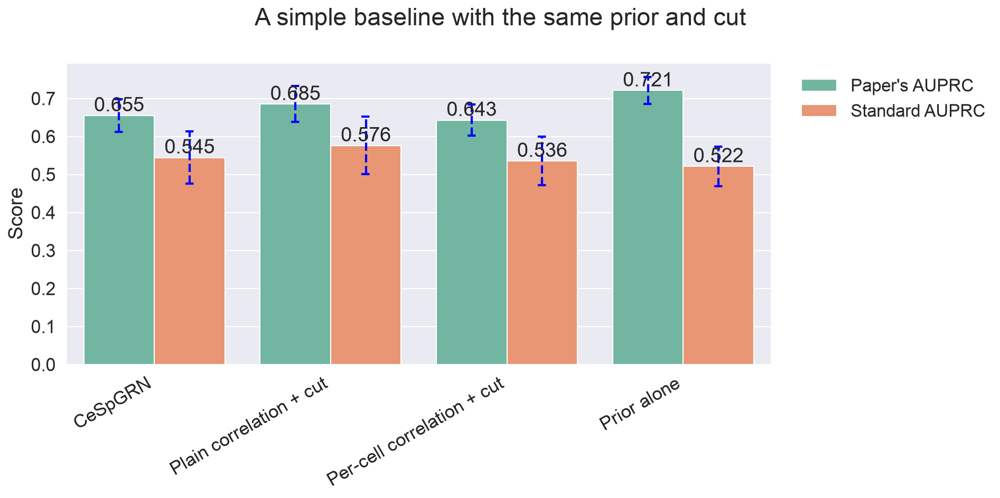
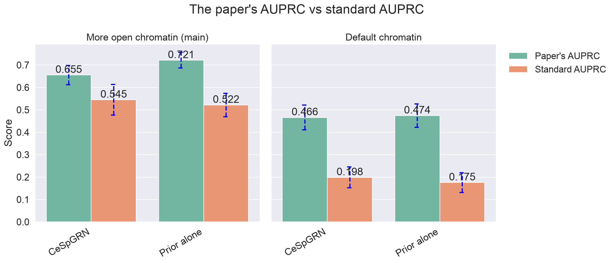

# Does CeSpGRN learn from RNA, or copy its prior?

CeSpGRN infers a gene regulatory network (GRN) for every single cell from RNA data. With scATAC-seq it also gets a **prior**: per cell, the set of TF → gene edges that the cell's open chromatin allows. On the paper's simulated benchmark this prior lifts accuracy (AUPRC) from about 0 to 0.76.

We ask where that gain comes from: does CeSpGRN learn the network from the RNA, or does it mostly hand back the prior it was given?

Paper: Zhang et al., *Bioinformatics* 42(6), btag324 (2026). Code: [PeterZZQ/CeSpGRN](https://github.com/PeterZZQ/CeSpGRN) `v1.0.0`. The detailed log, with dates, job IDs and code references, is in [`journal.md`](journal.md).

## Main result

**CeSpGRN's accuracy comes from the ATAC prior and a hard cut on edges outside it, not from its use of the RNA.**

- **Without the prior** CeSpGRN is close to random (experiment 1).
- **The cut does the work.** Keeping only the cut, and dropping the prior from CeSpGRN's equation, barely changes the score; the prior in the equation alone, without the cut, leaves CeSpGRN near random (experiment 4).
- **CeSpGRN gets little out of the RNA.** With the RNA's gene–gene signal destroyed by shuffling, CeSpGRN scores the same as the prior alone on standard AUPRC; with real RNA it is about 0.02 higher (experiment 3).
- **A simpler method gets more out of the same RNA.** Plain correlation over all cells, with the same prior and cut, scores higher than CeSpGRN on standard AUPRC in 90% of cells (experiment 7).
- **The AUPRC in the authors' code hides this.** It inflates scores that are tied or zero, which flatters priors; on the paper's AUPRC the prior alone even scores higher than CeSpGRN (experiment 8).

**Figure 1.** The four combinations side by side. *CeSpGRN + ATAC*: CeSpGRN with the real RNA and the ATAC prior, as in the paper. *ATAC + shuffled RNA*: the same, but with each gene shuffled across cells, so the RNA carries no signal. *ATAC only*: the prior on its own, no RNA. *CeSpGRN only*: CeSpGRN with the real RNA and no prior. Mean over 8000 cells, error bars one standard deviation.

All numbers are 8000 cells, one seed, noise 0.01, unless stated otherwise. See [Limits](#limits) before quoting them.

## How CeSpGRN works, in short

- **Input:** gene expression (RNA) for every cell, and per cell a **prior**: the TF → gene links that the cell's open chromatin (ATAC) allows.
- **Method:** for each cell, CeSpGRN estimates a network from the RNA of that cell and its neighbours (cells with similar expression). A penalty with weight β pushes it away from edges outside the prior. The paper describes the prior only through this penalty (Eq. 2, Algorithm 1), which it says is meant "to eliminate the impossible connections".
- **A step the paper does not describe:** after averaging, the authors' script sets every edge outside the prior to zero ([`test_scmultisim.py` L222–225](https://github.com/PeterZZQ/CeSpGRN/blob/2fb222f8a26edf1bdae14a95b1491543f0aaa4e8/test/scripts_scmultisim/test_scmultisim.py#L222-L225); the solver has the same step for its return value, [`src/g_admm.py` L654–659](https://github.com/PeterZZQ/CeSpGRN/blob/2fb222f8a26edf1bdae14a95b1491543f0aaa4e8/src/g_admm.py#L654-L659)). So the output can only contain edges the prior allows. We call this **the cut**.
- **Output:** the average of 16 runs (4 neighbourhood bandwidths × 4 sparsity levels), one network per cell.

**How we score**, per cell against the true network, then averaged over cells:
- **AUPRC:** overall accuracy of the edge ranking. 1 is perfect; random is about 0.025 here.
  - **The paper's AUPRC** is the AUPRC in the authors' code ([`bmk_beeline.py` L147–151](https://github.com/PeterZZQ/CeSpGRN/blob/2fb222f8a26edf1bdae14a95b1491543f0aaa4e8/src/bmk_beeline.py#L147-L151)), which the paper's figures appear to use; the module their figure scripts call was not published. It takes the area under the precision–recall curve with the trapezoid rule, which scikit-learn warns "can be too optimistic". For a yes/no prediction with recall r and precision p it draws two straight lines, from (0, 1) to (r, p) and from (r, p) to the end of the curve, and scores r(1 + p)/2 + (1 − r)(p + π)/2, where π is the share of true edges overall. Both lines inflate the score of priors, and of CeSpGRN after the cut, which is zero for most edges.
  - **Standard AUPRC** (`average_precision_score`) does not interpolate. We report both.
- **Early precision:** of the top k edges, the share that is true, with k the number of true edges or the number of non-zero predicted edges, whichever is smaller. When the prior allows fewer edges than there are true ones, early precision cannot see the order of the edges inside the prior, so CeSpGRN and the prior get the same value by construction. That happens in 18% of cells on the main dataset and 76% with default chromatin.

## The paper's claim

**Figure 2.** The paper's Fig. 2 (Zhang et al. 2026, p. 6). (a) Accuracy when only TF information is given. (b) Accuracy with scATAC-seq: CeSpGRN (ATAC) reaches AUPRC 0.76 and early precision 0.69 at noise 0.01, far above the other methods. The paper does not show the ATAC prior on its own.

## Experiments

### 1. Reproduce the paper's Fig. 2b · done

We rebuilt the benchmark (the code that made it is not published, see [Setup](#setup)) and ran CeSpGRN with the authors' code and settings, with two missing helper modules rebuilt. We land below the paper's score (0.66 vs 0.76 on the paper's AUPRC), with the same pattern: with the prior CeSpGRN does well, without it CeSpGRN is close to random.

**Figure 3.** Fig. 2b redrawn with the authors' own plotting code, adding the prior on its own. Left the paper's AUPRC, right early precision. Bars are the mean over 8000 cells, error bars one standard deviation. Two chromatin settings: the simulator's default (most chromatin closed, a weaker prior) and more open chromatin (our main setting, closest to the paper). The two settings are separate simulations, so the true networks differ too.

| 8000 cells, noise 0.01 | Paper's AUPRC | Standard AUPRC | Early precision |
|---|---|---|---|
| CeSpGRN with ATAC prior | 0.66 | 0.54 | 0.74 |
| ATAC prior alone | 0.72 | 0.52 | 0.74 |
| CeSpGRN without prior | 0.02 | 0.02 | 0.01 |
| *Paper: CeSpGRN with ATAC prior* | *0.76* | | *0.69* |

### 2. Score the prior on its own · done

The authors' evaluation code scores the prior on its own ([`eval_scores.py` L77–94](https://github.com/PeterZZQ/CeSpGRN/blob/2fb222f8a26edf1bdae14a95b1491543f0aaa4e8/test/scripts_scmultisim/eval_scores.py#L77-L94) for the ATAC prior, [L39–41](https://github.com/PeterZZQ/CeSpGRN/blob/2fb222f8a26edf1bdae14a95b1491543f0aaa4e8/test/scripts_scmultisim/eval_scores.py#L39-L41) for the TF prior). The script that draws Fig. 2b reads those scores but keeps only the five methods it plots, and no prior-only score appears in the paper or supplement. On our rebuild the prior alone scores higher than CeSpGRN on the paper's AUPRC (0.72 vs 0.66, in practically every cell) and the same on early precision (Figure 3). With the default chromatin both score 0.47.

### 3. Shuffled RNA · done

We shuffled each gene's expression across cells and ran CeSpGRN with the real prior. Each gene keeps its values, but every relation between genes is destroyed, so the RNA carries no regulatory signal. CeSpGRN then scores the same as the prior alone on standard AUPRC (0.525 vs 0.522; higher in 55% of cells, a coin flip). With real RNA it scores 0.545, higher than the prior in 81% of cells. So the RNA's contribution through CeSpGRN is about 0.02, and it shows up only as a slightly better order of the edges the prior already allows: inside the prior, real RNA scores 0.78, shuffled RNA 0.75, the same as a random order (right panel). On the paper's AUPRC real RNA is also 0.02 ahead (0.655 vs 0.635); early precision cannot show the difference (0.744 for both), partly by construction.

**Figure 4.** CeSpGRN with real and shuffled RNA, both with the real prior. Left: standard AUPRC over the whole network, next to the prior alone. Right: standard AUPRC over only the edges the prior allows, next to the expected score of a random order. Mean over 8000 cells, error bars one standard deviation.

### 4. Penalty or cut: which one does the work? · done

CeSpGRN uses the prior twice: as a penalty in its equation (what the paper describes) and as the cut afterwards (what the code also does). We switched them on and off separately. At the paper's β = 1, the penalty alone barely changes the network (0.03, near random), though consistently a little. The cut alone gives almost the whole score (0.65 of 0.66 on the paper's AUPRC; 0.537 vs 0.545 standard, so the penalty adds a small amount on top of the cut). The penalty also acts on the diagonal of the network, because the authors' masks block it; that is part of "penalty only" too.

**Figure 5.** CeSpGRN with neither, one or both uses of the prior. Mean over 8000 cells, error bars one standard deviation.

### 5. Worse priors · done

We gave CeSpGRN the same RNA with worse priors: a noisier prior (30% of the region–gene links moved to wrong pairs), one prior shared by all cells (the edges allowed in the most cells, as many as a cell allows on average), and a random prior with the same number of edges per cell. CeSpGRN follows its prior every time. With each of the non-random priors, CeSpGRN stays within about 0.02 of the prior alone on standard AUPRC, just above it, and below it on the paper's AUPRC. With the random prior it falls to chance (0.03); that prior mostly allows pairs of non-TF genes, which can never be true, so it is a harsh test, and the clearer evidence that the RNA alone cannot recover the network is CeSpGRN without any prior (0.02).

One prior shared by all cells scores lower than the per-cell prior (0.38 vs 0.54 standard AUPRC). The shared prior is also less precise (0.61 vs 0.74 of its edges true), so this is not a pure test of the per-cell information, but either way the effect reaches the output through the prior, not through the RNA.

**Figure 6.** CeSpGRN and its prior alone, for the real per-cell prior and three worse ones. Left the paper's AUPRC, right standard AUPRC. Mean over 8000 cells, error bars one standard deviation.

### 6. Inside the prior: does the RNA order the allowed edges? · done

Among the edges the prior allows, 74% are true. We score only those edges: does CeSpGRN put the true ones first? A little: standard AUPRC 0.78, against 0.75 expected for a random order of the same edges. CeSpGRN without the prior, ranking the same edges, also scores 0.78. So the small gain comes from correlations in the RNA, not from how CeSpGRN uses the prior.

**Figure 7.** Standard AUPRC counted only over the edges the prior allows. "Random order" is the exact expected AUPRC of a random ordering of those edges, computed per cell from the number of allowed and true edges. Mean over 8000 cells, error bars one standard deviation.

### 7. A simple baseline with the same prior · done

We gave correlation the same prior and cut, in two versions: the Pearson correlation of each gene pair over all cells (one network, the same for every cell), and the per-cell neighbourhood correlation CeSpGRN starts from (before the solver's own smoothing over cells and its optimisation). Plain correlation over all cells scores higher than CeSpGRN: standard AUPRC 0.576 vs 0.545, higher in 90% of cells, and 0.69 vs 0.66 on the paper's AUPRC; early precision is about level. The per-cell correlation with the cut scores slightly below CeSpGRN (0.536 vs 0.545). So CeSpGRN's machinery adds little over a correlation, and on this benchmark a simple correlation over all cells does better. The two baselines also differ in how correlation is measured (Pearson vs weighted Kendall), not only in per-cell vs all cells.

**Figure 8.** CeSpGRN next to two correlation baselines that get the same prior and cut, and the prior alone. Mean over 8000 cells, error bars one standard deviation.

### 8. Standard AUPRC · done

On the paper's AUPRC the prior alone scores higher than CeSpGRN. With standard AUPRC the order flips: CeSpGRN is slightly ahead (0.54 vs 0.52, and 0.20 vs 0.18 with default chromatin). So "the prior beats CeSpGRN" is partly an effect of the metric. The paper's AUPRC also inflates all scores: with default chromatin it reads 0.47 where standard AUPRC gives 0.20. Because methods that score every edge are inflated much less than networks that are mostly zero, this metric likely widens CeSpGRN's lead over the other methods in the paper's Fig. 2b; we did not run those methods, so we cannot say by how much.

**Figure 9.** The paper's AUPRC next to standard AUPRC, for CeSpGRN and the prior alone, in both chromatin settings. Mean over 8000 cells, error bars one standard deviation.

Not run: a sweep over β (the paper's Fig. S4a already shows it is flat), GENIE3 as a second baseline (experiment 7 is clear without it), noise 0.1, and more seeds.

## What else we found

1. **The paper's β experiment cannot separate penalty from cut.** In the code, "without β" loads no prior at all, and any β above zero also switches the cut on. That fits the flat β sweep the supplement presents as robustness (Fig. S4a; Note 1.6: "which shows the robustness of CeSpGRN with regard to the selection of β"), and experiment 4 is consistent with it.
2. **The simulated prior is built from the true network.** The simulator links a TF to a chromatin region only if that TF positively regulates a gene linked to the region (scMultiSim's `.regionToTFMatrix`). The supplement says the priors are "constructed from the cross-modality relationship matrix" and that it takes those matrices "directly from scMultiSim" (Notes 1.7, 1.8), so the authors' prior was very likely built the same way. Chromatin only decides which of those edges are closed in each cell. That makes the prior more informative than a prior from motifs in real data would be.
3. **The benchmark is only loosely described.** The code that builds the priors and adds noise is not public. Note 1.8 says the noise level "measures the amount of false positive connections" in both the region × TF and the region × gene matrix, but not how that amount is defined. How much chromatin is open is not stated at all. Both change the prior's quality a lot. We have asked the authors for their settings.
4. **Single settings may tell a different story than the average** (400 cells only). In a small test, no single setting beat the prior's AUPRC, but some ordered the prior's edges better: early precision up to 0.93 against the prior's 0.81. At high λ early precision is computed over fewer edges, which flatters it. Experiment 6 asks the same question at full size for the average and finds only a small gain.

## Limits

- **One seed, one noise level** (0.01) for everything on the rebuilt benchmark.
- **Cells are not independent.** CeSpGRN smooths each cell's network over its neighbours, so "higher in x% of cells" describes consistency across cells, not a statistical test. We give no p-values.
- **Our noise is milder than the paper describes.** Note 1.8 adds false links to both matrices; we move a share of the region–gene links to wrong pairs and leave the region × TF matrix clean. Together with more open chromatin, that makes our main prior favourable. Our first rebuild, with false links added to both matrices as Note 1.8 describes, gave a much weaker prior and the same conclusion at noise 0.01 (at noise 0.1 the prior alone scored about twice as high as CeSpGRN on the paper's AUPRC).
- **Chromatin settings are separate simulations.** Changing how much chromatin is open also changes the random draws for the RNA and the network, so the two settings differ in more than chromatin.
- **The covariance weighting is our choice.** The authors' script does not say whether its covariance uses neighbourhood weights; their commented-out reference code defaults to unweighted, the paper's equation is weighted, and we use weighted. This could shift absolute scores, not the comparisons between networks built from the same input.
- **The paper's AUPRC is inferred** from the authors' code; the scoring module their figure scripts call was not published.

## Setup

- **Data.** Simulated with scMultiSim using the settings encoded in the authors' dataset names, giving the 110 genes of Note 1.8 and the 330 regions of the authors' code. Where the paper is silent we chose: the simulator's example tree and 20 cell identity factors; a region counts as open when it has any ATAC reads; noise moves a share of the real region–gene links to wrong pairs (see [Limits](#limits) for how this differs from Note 1.8).
- **More open chromatin.** By default the simulator makes 80% of ATAC values zero, which leaves most true edges outside the prior. We use 20% zeros, because that gives a prior as strong as the paper's scores imply. We picked it to match the paper, so the default is kept as a check.
- **A first rebuild** used the simulator's defaults and added false links to every empty entry of both matrices, which at 0.01 already tripled the region–gene links. Its prior was much weaker (AUPRC 0.37) and gave the same conclusion at noise 0.01. Details in [`journal.md`](journal.md).
- **Method and scoring.** The authors' CeSpGRN code, settings and metrics; see the table below.
- **Code.** Everything we wrote is in [`ablation/`](ablation/README.md). Figures are drawn by `ablation/plots/`; the cell-by-cell comparisons by `ablation/tools/paired_differences.py`.

### How we run CeSpGRN

The settings of the authors' code and of supplement Notes 1.1 and 1.4:

| Setting | Supplement / paper | Authors' script | Ours |
|---|---|---|---|
| Bandwidth σ | 0.01, 0.1, 1, 10 | same | same |
| Sparsity λ | 0.01, 0.05, 0.1, 0.5 | same | same |
| Prior weight β | 1 | 1 | 1 (and 0 for the no-prior run) |
| Neighbourhood size Ni | 100 | 100 | 100 |
| k-NN graph | smallest k > 5 that connects the graph | `calc_kernel_neigh`, starting at k = 5 with the cell itself counted | same code |
| Final network | average over all 16 σ × λ | same | same |
| Covariance | neighbourhood-weighted Kendall's τ (Eq. 6) | module never published; called without saying whether it is weighted | rebuilt from their commented-out code, weighted (our choice) |
| Solver settings | ρ = 1.7 (Note 1.1) | α 2, ρ 1.7, 100 iterations, batches of 512 | same |
| Normalisation | not stated | library size + log1p, PCA with 20 components | same |

Where we differ, and why it is safe:

- **The cut** is in the code but not described in the paper. We follow the code, because that is what produced their numbers.
- **Two speed changes** (see [Changes to upstream code](#changes-to-upstream-code)) give identical results; an audit reran them against the original code on synthetic data with zero difference.
- **The two missing modules** (`cov`, `bmk`) are rebuilt from the paper and the authors' commented-out code.
- **The data and the prior** are rebuilt, because the code that made them is not published (see above).

## Changes to upstream code

- **Compatibility fixes** for functions removed from PyTorch, scikit-learn and NumPy.
- **A speed fix.** As published, the solver takes a matrix square root for one cell at a time, which would take days per dataset at 8000 cells. We compute them for all cells at once. On the small test dataset the scores are identical.

Neither change affects the results. Two helper modules the authors' scripts import were never published; we wrote our own in `ablation/lib/`. Details in [`journal.md`](journal.md#changes-to-upstream-code).
